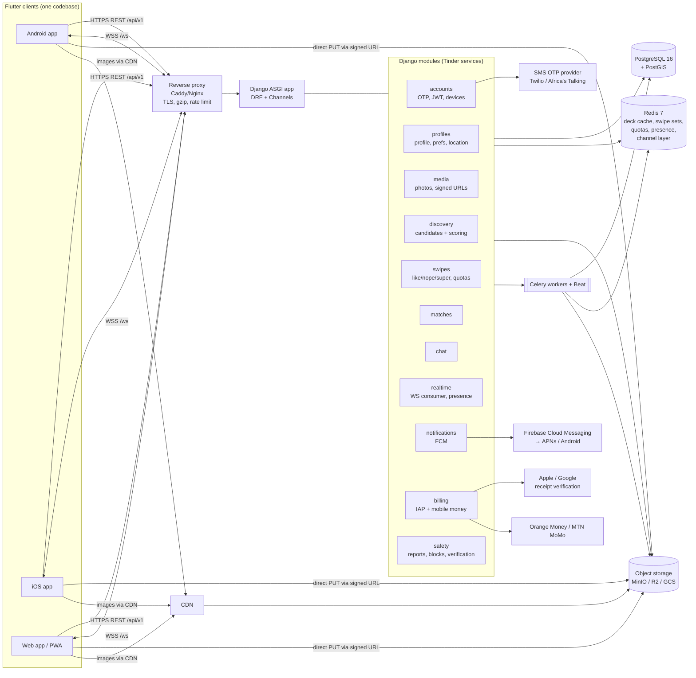

# Pepper — System Architecture (v1)

> **Pepper** is a working name (red chili = our brand color, and "fiery" without borrowing Tinder's flame). Change it in one place: `APP_NAME` in `.env` and `app/lib/core/config/brand.dart`.
>
> **Goal:** a full-featured dating product for Liberia and the Liberian diaspora that runs as a **React web app plus Flutter Android and iOS apps**, with a **black / red / white** visual identity.
>
> **Ground rule:** we copy Tinder's *patterns* (card stack, swipe gestures, match flow, tab layout, monetisation model, backend topology). We do **not** copy Tinder's name, flame logo, wordmark, gradient, icons, sounds or marketing copy (e.g. "It's a Match!"). Apple rejects copycat apps and trademark use is a legal risk.

> **Authoritative implementation amendment (2026-11-15):** Pepper uses React + TypeScript in `web/`, Flutter only for Android/iOS in `app/`, Express + TypeScript in `server/`, PostgreSQL/PostGIS with explicit SQL migrations, Redis/BullMQ workers, and Socket.IO realtime. Express routes are thin; module business logic lives in `services.ts`, reads in `repositories.ts`, and modules call one another through exported services. This amendment supersedes any remaining legacy Django, Celery, or Flutter-web implementation examples below; those passages retain product intent only.

---

## 0. Key decisions at a glance

| Concern | Decision | Why |
|---|---|---|
| Clients | **React + TypeScript web; Flutter 3 mobile** | Web and mobile share API behavior while using platform-appropriate clients |
| Backend | **Express 5 + TypeScript + Socket.IO** | Thin HTTP routes, module services/repositories, authenticated realtime gateway |
| Architecture style | **Modular monolith** whose modules mirror Tinder's microservices 1-to-1 | One deployable now; each module can be lifted out into its own service later without redesign |
| Primary DB | **PostgreSQL 16 + PostGIS** | Geo queries (`ST_DWithin`) for discovery; relational integrity for matches/payments |
| Cache / pub-sub / quotas | **Redis 7** | Deck cache, swipe sets, rate limits, presence, and BullMQ coordination |
| Async jobs | **BullMQ + Redis** | Deck rebuilds, image processing, subscription expiry, top picks, account deletion |
| Media | **S3-compatible object storage** (MinIO locally → Cloudflare R2 or GCS in prod) + signed upload URLs | Clients upload directly; backend never proxies bytes |
| Realtime | WebSocket per online user, server-side per-user group; **FCM** push when offline | Same pattern Tinder describes (per-user subscription behind a WebSocket tier) |
| Auth | **Phone number + SMS OTP** (primary), Google & Sign in with Apple (secondary); JWT access/refresh | Phone-first market; Apple requires a privacy-focused login option if you offer Google |
| Payments | **App Store / Google Play IAP on mobile**, **Orange Money & MTN MoMo on web**, pluggable provider interface | Store rules require IAP for digital subscriptions inside mobile apps; mobile money is how Liberians pay |
| Geo-sharding | `geo_cell` column (S2 cell id, level 6) on every location row, indexed | Liberia fits in one shard today; the key is there so we can shard like Tinder when we grow |

---

## 1. Product scope (Tinder feature parity)

| Tinder feature | Pepper equivalent | Release |
|---|---|---|
| Card stack, swipe left/right, tap through photos | Same | **MVP** |
| Like / Nope buttons, LIKE / NOPE stamps while dragging | Same (red / white stamps) | **MVP** |
| Super Like (swipe up, star) | **Super Like** — target sees a red star border on your card | **MVP** |
| Match screen → send message | "You matched!" screen | **MVP** |
| Matches row + conversation list | Same | **MVP** |
| 1-to-1 chat, typing, read receipts, GIFs | Text + emoji + photos + read receipts (paid) + typing; GIFs later | **MVP** (GIFs v1.1) |
| Discovery settings: distance, age, show-me | Same, plus **county** filter | **MVP** |
| Profile: up to 9 photos, bio, job, school, interests, prompts | Same, plus languages spoken (Kpelle, Bassa, Vai, Kru, Liberian English…) and county / hometown | **MVP** |
| Photo verification (blue check) | Selfie pose verification → red check badge | **MVP** (manual review), auto v1.1 |
| Report / block / unmatch | Same | **MVP** (store requirement) |
| Rewind | Same (paid) | **MVP** |
| Boost (30 min top-of-deck) | Same | **MVP** |
| Likes You (blurred for free users) | Same, blurred **server-side** | **MVP** |
| Passport (swipe anywhere) | **Passport** — key for diaspora (e.g. Minnesota, Philadelphia, Accra → Monrovia) | **MVP** |
| Plus / Gold / Platinum tiers | Same three tiers (names configurable) | **MVP** |
| Top Picks | Daily 10 curated profiles (paid) | v1.1 |
| Explore tab / interest-based modes | Explore tab with themed decks ("Looking for serious", "New in town", "Church folks", "Same county") | v1.1 |
| Smart Photos | Auto-reorder photos by like-rate | v1.1 |
| Message before matching (Platinum) | Same | v1.1 |
| Incognito / only seen by people I like | Same | v1.1 |
| Video chat | Later (bandwidth) | v2 |

---

## 2. Tinder's published architecture → our mapping

Tinder has documented parts of its backend on its engineering blog:

- **Geosharded recommendations** — users are indexed in search shards keyed by **Google S2 cells**; a query fans out only to the cells covering the user's distance radius. ([Part 1](https://medium.com/tinder/geosharded-recommendations-part-1-sharding-approach-d5d54e0ec77a), [Part 2](https://medium.com/tinder/geosharded-recommendations-part-2-architecture-3396a8a7efb), [Part 3](https://medium.com/tinder/geosharded-recommendations-part-3-consistency-2d2cb2f0594b))
- **Real-time delivery** — every client keeps a WebSocket; the socket tier subscribes to a per-user subject on **NATS**, multiplexing many users per process. ([How Tinder delivers matches and messages](https://medium.com/tinder/how-tinder-delivers-your-matches-and-messages-at-scale-504049f22ce0))
- **Platform** — microservices on **Kubernetes** behind an **Envoy** mesh, fronted by a custom API gateway ("TAG"). ([API Gateway](https://medium.com/tinder/how-we-built-the-tinder-api-gateway-831c6ca5ceca))

| Tinder component | Pepper v1 (launch) | Pepper at scale |
|---|---|---|
| API Gateway (TAG) | Caddy/Nginx reverse proxy + DRF auth/throttling middleware | Dedicated gateway (Envoy / Cloud Endpoints) |
| Profile service | `profiles` Django app | Separate service |
| Recommendation service + Elasticsearch geoshards | `discovery` app: PostGIS candidate query + Python scorer + Redis deck cache | OpenSearch index sharded by `geo_cell`, scorer as its own service |
| Swipe service + swipe queue | `swipes` app: synchronous write + Redis sets for O(1) match check; Celery for analytics | Kafka/NATS swipe stream |
| Match service | `matches` app | Separate service |
| Chat service | `chat` app (Postgres, cursor pagination) | Separate service, Cassandra/Scylla if volume demands |
| WebSocket tier + NATS | Django Channels + Redis channel layer, per-user group `user.<id>` | Go WebSocket gateway + NATS |
| Push service | `notifications` app → FCM (covers APNs) | Same, own service |
| Payments / entitlements | `billing` app | Same, own service |
| Trust & Safety | `safety` app + Django Admin moderation queue | Dedicated T&S tooling + ML classifiers |

---

## 3. System diagram



---

## 4. Tech stack (pinned majors)

**Backend** — Python 3.12, Django 5.x, djangorestframework, djangorestframework-simplejwt, drf-spectacular (OpenAPI), channels 4 + channels-redis, daphne or uvicorn, celery 5 + django-celery-beat, psycopg 3, django.contrib.gis (PostGIS), django-environ, django-storages + boto3, Pillow + pillow-avif/webp, blurhash-python, s2sphere (geo cell ids), phonenumbers, firebase-admin, sentry-sdk (optional), pytest + pytest-django + factory-boy + pytest-asyncio, ruff, mypy (lenient).

**Client** — Flutter 3.x stable, Dart 3; flutter_riverpod (+ riverpod_generator), go_router, dio (+ interceptors for JWT refresh), web_socket_channel, freezed + json_serializable, flutter_secure_storage (mobile) / shared_preferences (web fallback), cached_network_image, flutter_blurhash, image_picker, image_cropper, geolocator, permission_handler, firebase_core + firebase_messaging (optional at runtime), in_app_purchase, intl, flutter_svg, lottie (match animation), very_good_analysis lints.

**Infra** — Docker + Docker Compose (local), Caddy (TLS), MinIO (local S3), Mailpit (dev email), GitHub Actions CI, Codemagic or GitHub macOS runners for iOS builds.

---

## 5. Repository layout (monorepo)

```
pepper/
├── AGENTS.md                  # rules for coding agents
├── README.md
├── PROGRESS.md                # phase checklist kept up to date by the agent
├── docs/
│   ├── ARCHITECTURE.md        # this file
│   ├── API.md                 # generated from OpenAPI + WS event reference
│   └── RUNBOOK.md             # local dev, emulator, deployment
├── docker-compose.yml         # postgres(postgis), redis, minio, mailpit, api, worker, beat
├── .env.example
├── Makefile                   # make up / test / seed / lint (macOS/Linux)
├── scripts/                   # dev.ps1, test.ps1, seed.ps1 (Windows parity)
├── backend/
│   ├── manage.py
│   ├── pyproject.toml
│   ├── config/                # settings/{base,dev,test,prod}.py, asgi.py, urls.py, celery.py
│   └── apps/
│       ├── core/              # base models, pagination, permissions, throttles, s2 utils
│       ├── accounts/
│       ├── profiles/
│       ├── media/
│       ├── discovery/
│       ├── swipes/
│       ├── matches/
│       ├── chat/
│       ├── realtime/
│       ├── notifications/
│       ├── billing/
│       └── safety/
├── app/                       # Flutter project (android/, ios/, web/, lib/, test/)
│   └── lib/
│       ├── main.dart
│       ├── core/              # config, theme, router, network (dio, ws), storage, utils, widgets
│       └── features/
│           ├── auth/          # phone entry, OTP, social sign-in
│           ├── onboarding/    # name, DOB, gender, show-me, photos, interests, location
│           ├── discovery/     # card stack, action bar, card detail
│           ├── explore/       # themed decks (v1.1, stub screen in MVP)
│           ├── likes/         # Likes You grid
│           ├── matches/       # new-matches row + conversation list
│           ├── chat/          # thread, composer
│           ├── profile/       # view/edit profile, photo grid
│           ├── settings/      # discovery prefs, account, privacy, delete account
│           ├── paywall/       # tiers, IAP / mobile money
│           └── safety/        # report, block, verification
└── .github/workflows/         # backend-ci.yml, app-ci.yml
```

Each Django app owns: `models.py`, `serializers.py`, `views.py`, `urls.py`, `services.py` (all business logic lives here, not in views), `selectors.py` (read queries), `tasks.py`, `tests/`. **Modules talk to each other only through `services.py` functions** — this is the seam that lets us split into microservices later.

Each Flutter feature owns: `data/` (DTOs, repository using Dio), `domain/` (models), `application/` (Riverpod notifiers), `presentation/` (screens, widgets).

---

## 6. Data model

All primary keys are **UUIDv7** (time-ordered, safe to expose). All tables have `created_at`, `updated_at`.

### accounts
- **User** — `id`, `phone_e164` (unique, nullable), `email` (nullable), `is_active`, `is_staff`, `status` (`active|paused|banned|deleted`), `last_active_at`, `date_joined`.
- **SocialIdentity** — `user`, `provider` (`google|apple`), `subject` (unique per provider).
- **OtpChallenge** — `phone_e164`, `code_hash`, `expires_at`, `attempts`, `consumed_at`, `ip`. Max 5 attempts, 5-min expiry, 3 sends / 15 min / phone.
- **Device** — `user`, `platform` (`android|ios|web`), `fcm_token`, `app_version`, `last_seen_at`.

### profiles
- **Profile** (1-1 User) — `display_name`, `birth_date` (must be 18+), `gender` (`woman|man|nonbinary`), `show_gender_on_profile` (bool), `orientation` (optional, **hidden by default**, field-encrypted), `bio` (≤500), `job_title`, `company`, `school`, `county` (enum of Liberia's 15 counties + `diaspora`), `hometown`, `languages` (array), `height_cm`, `relationship_goal` (`long_term|long_term_open|short_term_open|short_term|friends|figuring_out`), `religion` (optional, hidden by default), `prompts` (JSON: up to 3 Q/A), `completeness` (0–100, computed), `is_verified`, `verification_status`.
- **Interest** (catalogue) + **ProfileInterest** (M2M, max 5).
- **DiscoveryPreference** (1-1) — `show_me` (set of genders), `age_min`, `age_max`, `max_distance_km` (2–160), `counties_filter` (optional), `global_mode` (bool), `is_discoverable` (bool; false = paused/incognito).
- **Location** (1-1) — `point` (PostGIS `geography(Point)`), `geo_cell` (S2 level-6 id, bigint, indexed), `accuracy_m`, `source` (`gps|ip|manual_county`), `updated_at`; **PassportLocation** (nullable override: `point`, `label`, `expires_at`).

### media
- **Photo** — `user`, `position` (0–8), `original_key`, `variants` (JSON: `{"sm":key,"md":key,"lg":key,"blur":key}` WebP 320/720/1080 + a heavily blurred 320 copy used for "Likes You" on the free tier), `blurhash`, `width`, `height`, `moderation_status` (`pending|approved|rejected`), `like_score` (for Smart Photos). EXIF (incl. GPS) **always stripped**.

### swipes
- **Swipe** — `swiper`, `swipee`, `action` (`like|nope|superlike`), `created_at`, `rewound` (bool). Unique `(swiper, swipee)`. Index `(swipee, action)` for Likes You.
- Redis mirrors: `likes_in:{user}` (SET of user ids who liked/superliked them), `swiped:{user}` (SET of everyone they've swiped on), `quota:likes:{user}:{window}`, `quota:super:{user}:{day}`.

### matches
- **Match** — `user_a`, `user_b` (stored with `user_a < user_b`, unique pair), `created_at`, `unmatched_at`, `unmatched_by`, `last_message_at`, `initiated_by_superlike` (bool).

### chat
- **Message** — `match`, `sender`, `client_id` (UUID from client, unique per sender → idempotent retries), `kind` (`text|image|system`), `body`, `media_key`, `created_at`, `delivered_at`, `read_at`, `deleted_at`. Index `(match, created_at desc)`.

### notifications
- **NotificationPreference** — per-user toggles (new match, message, likes, promos).
- **NotificationLog** — what was sent, for debugging and de-duplication.

### billing
- **Product** — `sku`, `tier` (`plus|gold|platinum`) or `consumable` (`superlike_pack|boost_pack`), `duration_days`, `quantity`, `price_usd`, `price_lrd`, `store_product_id_ios`, `store_product_id_android`, `active`.
- **Purchase** — `user`, `product`, `provider` (`apple|google|orange_money|mtn_momo|fake`), `provider_ref` (unique), `status` (`pending|succeeded|failed|refunded`), `amount`, `currency`, `raw_payload` (JSON).
- **Subscription** — `user`, `tier`, `starts_at`, `expires_at`, `auto_renew`, `provider`, `original_transaction_id`.
- **Wallet** — `user`, `superlikes_balance`, `boosts_balance`.
- **Entitlements** are **computed** (`billing.services.get_entitlements(user)`), cached in Redis 60 s, never stored as booleans on User.

### safety
- **Block** — `blocker`, `blocked` (unique pair). Blocks are **bidirectional** in every query.
- **Report** — `reporter`, `reported`, `reason` (`fake_profile|underage|harassment|scam|nudity|offensive|other`), `details`, `message` (nullable FK), `status` (`open|actioned|dismissed`), `handled_by`, `handled_at`.
- **Verification** — `user`, `pose_code`, `selfie_key`, `status`, `reviewed_by`.
- **ModerationAction** — audit trail of bans, photo removals, warnings.

---

## 7. Core flows

### 7.1 Sign-up / onboarding
1. Phone screen (country code defaults to **+231**, validated with `phonenumbers`) → `POST /auth/otp/request`.
2. OTP screen → `POST /auth/otp/verify` → returns `{access, refresh, is_new_user}`.
3. If new: onboarding wizard — first name → birthday (blocks under-18, cannot be edited later without support) → gender → show me → relationship goal → **photos (min 2)** → interests (optional) → location permission (fallback: pick county) → notifications permission.
4. `POST /profiles/me/complete` marks onboarding done; discovery is unlocked only when profile has ≥2 approved-or-pending photos, a birthday and a location.

### 7.2 Discovery deck (the core loop)
1. Client calls `GET /discovery/deck?limit=20`. Server pops from Redis list `deck:{user}`.
2. If the list has < 10 ids left, enqueue `discovery.tasks.rebuild_deck(user)` (and build synchronously if empty).
3. Response contains **card DTOs**: id, name, age, verified, distance label (e.g. `"3 km away"` — never coordinates), county, job/school, bio, interests, prompts, photo URLs (CDN, `md` + `lg`), blurhashes, `superliked_you` flag.
4. Client keeps a local buffer of ~20 cards, renders top 2 (current + next) and pre-caches the next 3 cards' first photos.

### 7.3 Swipe → match
```
POST /swipes {target_id, action, client_ts}
  ├─ validate: not self, not blocked, target discoverable, not already swiped
  ├─ quota check (Redis INCR with TTL) unless entitlement.unlimited_likes
  ├─ DB transaction:
  │    insert Swipe (ON CONFLICT DO NOTHING → idempotent)
  │    if like/superlike and target in likes_in:{me}  →  create Match (ordered pair)
  ├─ Redis: SADD swiped:{me} target; if like → SADD likes_in:{target} me; LREM deck:{me} target
  ├─ on_commit:
  │    if match: publish match.created to user.{me} and user.{target}; push to offline user
  │    elif superlike: push "Someone Super Liked you" to target
  └─ return {matched: bool, match?: MatchDTO, quotas: {likes_left, superlikes_left, resets_at}}
```
**Rewind** (`POST /swipes/rewind`): undo the user's most recent swipe if it was a `nope` within the session and no match exists; re-insert the target at the top of the deck. Paid.

### 7.4 Chat delivery
1. Client sends `message.send` over WebSocket **or** `POST /matches/{id}/messages` (fallback) with a client-generated `client_id`.
2. Server validates membership + not unmatched/blocked, persists, then publishes `message.new` to both users' groups (sender gets it as an ack with server id + timestamp).
3. If recipient has no live socket (`presence:{user}` key missing), Celery sends FCM push with sender name + preview (preview hidden if user disables it).
4. Read receipts: `message.read {match_id, up_to_message_id}`; delivered to sender only if sender's entitlements include `read_receipts`.
5. History: `GET /matches/{id}/messages?before=<cursor>&limit=30` (cursor = message id).

### 7.5 Purchase
- **Mobile**: `in_app_purchase` → client receives purchase token/receipt → `POST /billing/verify {provider, product_sku, receipt}` → server verifies with Apple (App Store Server API) / Google (Play Developer API) → creates Purchase + Subscription/Wallet credit → returns entitlements. Store server notifications (`/billing/webhooks/apple`, `/billing/webhooks/google`) handle renewals/refunds.
- **Web**: `POST /billing/mobile-money/initiate {sku, provider, msisdn}` → provider sends USSD/PIN prompt to the user's phone → provider webhook `/billing/webhooks/{orange|mtn}` → mark succeeded → push `entitlements.updated` over WebSocket.
- **Dev**: `fake` provider that succeeds instantly (enabled only when `DEBUG=True`).

---

## 8. Recommendation engine (`discovery`)

### Candidate generation (SQL, PostGIS)
Effective location = active PassportLocation or Location. Filter:
- `ST_DWithin(candidate.point, me.point, me.max_distance_km*1000)` (skip if `global_mode`)
- candidate.gender ∈ my `show_me` **and** my gender ∈ candidate's `show_me` (**mutual**)
- candidate age ∈ my range **and** my age ∈ candidate's range (**mutual**)
- candidate `is_discoverable`, `status=active`, ≥2 photos, active within 30 days
- not me, not in `swiped:{me}`, no Block in either direction, not already matched
- optional county filter

Pre-filter by `geo_cell IN (cells covering the radius)` before the PostGIS distance check — the same trick Tinder uses with S2 shards, and the hook for real sharding later. Cap at 500 candidates.

### Scoring (Python, weights in settings so they can be tuned)
```
score =  0.30 * recency        # exp decay on last_active_at (half-life 3 days)
       + 0.20 * proximity      # 1 - distance/max_distance
       + 0.15 * completeness   # profile completeness 0..1
       + 0.15 * desirability   # Bayesian like-rate: (likes_in + 5) / (swipes_in + 20)
       + 0.10 * new_user       # 1.0 for first 72h, decaying
       + 0.10 * shared_signal  # shared interests / languages / county / goal
       + 0.5  * liked_me       # candidate already liked me (raises match yield)
       + 1.0  * boost_active   # candidate has a live Boost
       + 0.05 * random()       # exploration jitter
```
Then **diversify** (don't show >3 consecutive cards from the same score band of desirability; interleave `liked_me` at most 1 in 4 so it doesn't feel rigged), take top 200, `RPUSH deck:{user}`, TTL 6 h.

**Super Likes** received are surfaced near the top of the recipient's next deck.

### Scale path
When active users exceed ~200k or deck build p95 > 300 ms: move candidate generation to OpenSearch with one index per S2 cell group (Tinder's geoshard design), run the scorer as a separate service, and add learned ranking (two-tower embeddings) — a natural fit for your ML background.

---

## 9. Realtime protocol

`wss://<host>/ws/?token=<access_jwt>` (token also accepted via `Sec-WebSocket-Protocol` for web). One socket per device. Server joins the connection to group `user.<id>`; sets `presence:{user}` (TTL 60 s), refreshed by client `ping` every 25 s. Client reconnects with exponential backoff (1 s → 30 s, jitter) and on reconnect calls `GET /sync?since=<ts>` to fetch missed matches/messages.

Envelope: `{"type": "...", "id": "<uuid>", "ts": "<iso8601>", "data": {...}}`

| Direction | type | data |
|---|---|---|
| C→S | `ping` | `{}` |
| C→S | `message.send` | `{match_id, client_id, kind, body?, media_key?}` |
| C→S | `message.read` | `{match_id, up_to_message_id}` |
| C→S | `typing` | `{match_id, is_typing}` |
| S→C | `pong` | `{}` |
| S→C | `message.new` | `MessageDTO` (includes `client_id` for ack) |
| S→C | `message.read` | `{match_id, up_to_message_id, read_at}` |
| S→C | `typing` | `{match_id, user_id, is_typing}` |
| S→C | `match.created` | `MatchDTO` (with other user's card) |
| S→C | `match.removed` | `{match_id}` (unmatch/block) |
| S→C | `like.received` | `{count}` (Likes You badge; identity only if Gold+) |
| S→C | `entitlements.updated` | `EntitlementsDTO` |
| S→C | `error` | `{code, message, ref_id?}` |

---

## 10. REST API surface (`/api/v1`)

| Area | Endpoints |
|---|---|
| Auth | `POST auth/otp/request`, `POST auth/otp/verify`, `POST auth/social/{google,apple}`, `POST auth/refresh`, `POST auth/logout` |
| Me | `GET/PATCH profiles/me`, `POST profiles/me/complete`, `GET/PATCH profiles/me/preferences`, `PUT profiles/me/location`, `PUT/DELETE profiles/me/passport`, `GET profiles/{id}` (only if in deck, matched, or liked-you+Gold) |
| Catalogue | `GET meta/interests`, `GET meta/counties`, `GET meta/languages`, `GET meta/prompts` |
| Media | `POST media/photos/upload-url` → `{upload_url, key}`, `POST media/photos {key, position}`, `PATCH media/photos/reorder`, `DELETE media/photos/{id}` |
| Discovery | `GET discovery/deck`, `GET discovery/top-picks` (v1.1) |
| Swipes | `POST swipes`, `POST swipes/rewind`, `GET swipes/quotas` |
| Likes | `GET likes/received` (blurred thumbnails + count for free; full for Gold+) |
| Matches | `GET matches?cursor=`, `DELETE matches/{id}` (unmatch) |
| Chat | `GET matches/{id}/messages?before=`, `POST matches/{id}/messages`, `POST matches/{id}/read`, `POST chat/upload-url` |
| Sync | `GET sync?since=` |
| Devices | `POST devices`, `DELETE devices/{id}` |
| Billing | `GET billing/products`, `GET billing/entitlements`, `POST billing/verify`, `POST billing/mobile-money/initiate`, `GET billing/purchases/{id}`, `POST billing/boost/activate`, webhooks |
| Safety | `POST safety/reports`, `POST safety/blocks`, `DELETE safety/blocks/{user_id}`, `POST safety/verification/start`, `POST safety/verification/submit` |
| Account | `POST account/pause`, `POST account/resume`, `GET account/export`, `DELETE account` (hard-delete after 30-day grace; store requirement) |
| Ops | `GET healthz`, `GET readyz`, `GET schema/` (OpenAPI), `GET docs/` (Swagger, DEBUG only) |

Conventions: JSON, snake_case, ISO-8601 UTC timestamps, cursor pagination `{results, next_cursor}`, errors `{"error": {"code": "QUOTA_EXCEEDED", "message": "...", "details": {...}}}`.

---

## 11. Monetisation & entitlements

| Entitlement | Free | Plus | Gold | Platinum |
|---|---|---|---|---|
| Likes | 50 per 12 h | Unlimited | Unlimited | Unlimited |
| Super Likes | 1 / day | 3 / day | 5 / day | 5 / day |
| Rewind | – | ✓ | ✓ | ✓ |
| Passport | – | ✓ | ✓ | ✓ |
| Hide ads / control who sees you | – | ✓ | ✓ | ✓ |
| Boost | buy | 1 / month | 1 / month | 1 / month |
| See who likes you | blurred + count | blurred + count | ✓ | ✓ |
| Top Picks | 1 / day | 1 / day | 10 / day | 10 / day |
| Read receipts | – | – | – | ✓ |
| Message before match | – | – | – | ✓ (v1.1) |
| Priority in decks | – | – | – | ✓ (score +0.2) |

All numbers live in `billing/entitlements.py` config, not hard-coded in views. Prices shown in **LRD and USD**; pick defaults after market testing (weekly plans are friendlier to mobile-money budgets than monthly).

---

## 12. Safety, privacy & trust

- **18+ only**: DOB required; under-18 → account blocked; underage reports auto-pause the reported account pending review.
- **Location privacy**: distances are computed server-side, rounded up to whole km with a ±0.5 km stable per-pair jitter, minimum label "less than 1 km away" — prevents trilateration. Exact coordinates never leave the server. Photos have EXIF stripped.
- **Sensitive fields** (orientation, religion): optional, hidden from profile by default, encrypted at rest, excluded from analytics exports and logs.
- **Block** hides both users from each other everywhere (deck, likes, matches, chat) immediately; **unmatch** removes the chat for both.
- **Report** from profile card, chat thread or match list; reporting a match also unmatches.
- **Photo moderation**: every upload is `pending`; a pluggable `ModerationProvider` (stub: auto-approve in dev; prod: a vision API or your own NSFW model) + human review queue in Django Admin.
- **Scam/spam heuristics**: first 3 messages to a new match are checked for phone numbers, WhatsApp/Telegram links, money requests ("send me MoMo", "transfer"); flagged messages get a soft warning banner to the recipient and raise a risk score.
- **Rate limits**: OTP, swipes, messages (30/min), reports, uploads.
- **Verification**: random pose code → selfie → reviewer compares with profile photos → red check badge.
- **Account deletion** inside the app (required by both Apple and Google), with data export.
- **Liberia data protection**: have a lawyer confirm current requirements before launch; design already supports export, deletion and minimisation.

---

## 13. Liberia-specific design

- **Phone-first**: +231 default; numbers on MTN (Lonestar Cell MTN) and Orange networks; SMS provider abstraction (`SMS_PROVIDER=console|twilio|africastalking`), with **console** printing codes in dev.
- **Low bandwidth / data cost**: WebP variants (sm/md/lg) chosen by connection type; blurhash placeholders; deck pages of 20; "Data saver" setting (sm images only, no autoplay); HTTP gzip/brotli; target first meaningful paint < 3 s on 3G.
- **Intermittent connectivity**: outbound message queue persisted locally and retried; swipes are idempotent and can be queued offline (replayed in order).
- **Location fallback**: if GPS is denied, pick a county; counties have centroid coordinates (Montserrado, Margibi, Bong, Nimba, Grand Bassa, Lofa, Grand Gedeh, Maryland, Sinoe, River Gee, Grand Kru, Rivercess, Gbarpolu, Grand Cape Mount, Bomi).
- **Diaspora**: Passport + "diaspora" county value + "Visiting Liberia on…" profile field (v1.1).
- **Language**: English UI with Liberian English-friendly copy; `intl` set up so Kpelle/Bassa strings can be added later. Profile "languages spoken" includes Liberian languages.
- **Payments**: Orange Money and MTN MoMo adapters behind `PaymentProvider` interface; LRD + USD prices.
- **Hosting region**: measure latency from Monrovia before choosing; West African traffic often routes via Europe, so a European region (e.g. GCP `europe-west1/2`) may beat Johannesburg.

---

## 14. Client architecture (Flutter)

- **Layers per feature**: presentation (widgets) → application (Riverpod `AsyncNotifier`s) → data (repositories, Dio, DTOs via freezed) . No widget calls Dio directly.
- **Networking**: single `ApiClient` (Dio) with base URL from `--dart-define=API_BASE_URL` (Android emulator default `http://10.0.2.2:8000`, web/iOS sim `http://localhost:8000`); interceptors: auth header, 401 → refresh → retry once, error mapping to `AppException`.
- **Realtime**: `RealtimeService` (singleton provider) owns the socket, exposes typed `Stream<RealtimeEvent>`; feature notifiers subscribe. Handles heartbeat, backoff, resync.
- **Routing (go_router)**: `/splash`, `/auth/phone`, `/auth/otp`, `/onboarding/*`, then a `StatefulShellRoute` with 5 tabs exactly like Tinder: **Discover** (`/`), **Explore** (`/explore`), **Likes** (`/likes`), **Chats** (`/matches`), **Profile** (`/profile`); plus `/matches/:id` (chat), `/profile/edit`, `/settings`, `/paywall?feature=…`, `/match-celebration`. Redirect guard: auth → onboarding complete → shell.
- **Swipe deck**: custom widget (no third-party lock-in): `GestureDetector` pan → translate + rotate (`angle = dx / width * 0.35 rad`), stamp opacity from drag progress, release threshold 30% width or fling velocity > 800 px/s, spring back otherwise; swipe-up = Super Like. Buttons trigger the same programmatic animation. Tap left/right third of photo = prev/next photo; progress bars at top; tap info "ⓘ" or swipe-up on bottom panel = expanded profile sheet.
- **Platform adaptivity**: on **web/desktop width > 900 px**, centre the card at 420×680 with a left sidebar holding Matches/Messages (Tinder web layout); keyboard shortcuts ← nope, → like, ↑ super like, space = next photo, ↓ open profile.
- **Push**: firebase_messaging initialised only if config files exist (`--dart-define=FIREBASE_ENABLED=true`); otherwise no-op so the app runs without Firebase during development.
- **Storage**: tokens in `flutter_secure_storage` (mobile), `shared_preferences` on web (access token in memory, refresh token stored).
- **Testing**: widget tests for deck physics, golden tests for key screens (light & dark), integration test for sign-up → swipe → match → chat against a local backend with seed data.

---

## 15. Design system

### Colors (Liberian-flag red as the brand anchor)
| Token | Hex | Use |
|---|---|---|
| `red500` (primary) | `#E0102D` | primary buttons, Like, active tab, badges |
| `red700` | `#BF0A30` | pressed states, gradient end, dark-mode primary |
| `red300` | `#FF4D63` | gradient start, highlights |
| `black` | `#000000` | dark background, text on light |
| `ink900` | `#0E0E10` | dark surface |
| `ink800` | `#1A1A1D` | dark cards / sheets |
| `ink600` | `#3A3A40` | dividers (dark) |
| `grey400` | `#8E8E93` | secondary text |
| `grey100` | `#F2F2F4` | light surface / input fill |
| `white` | `#FFFFFF` | light background, text on dark |
| `success` | `#1DB954` (sparingly) | verified/online dot only |

**Brand gradient** (logo, primary CTA, match screen): `LinearGradient(#FF4D63 → #E0102D → #BF0A30, 135°)`.

Both **light** (white bg, black text, red accents — Tinder's default look) and **dark** (black bg, white text, red accents) themes; follow system setting, overridable in Settings.

### Typography
`Montserrat` (ExtraBold 800 for headings/logo, SemiBold 600 for buttons) + `Inter` (body). Card name 32/800 white with age 28/400; body 16/400; caption 13/500.

### Components (Tinder-pattern, Pepper-styled)
- **Profile card**: full-bleed photo, radius 12, bottom 45% black→transparent gradient, name+age, verified red check, distance/county line, 2-line bio or chips; photo progress bars at top (white 90% active / 35% inactive).
- **Stamps** while dragging: "LIKE" (red, rotated −15°, top-left), "NOPE" (white, rotated +15°, top-right), "SUPER" (white text on red pill, bottom-centre). 4 px border, rounded 8.
- **Action bar** (5 circular buttons, white/ink background with shadow): Rewind (white, 48), Nope ✕ (white/black icon, 60), Super Like ★ (red outline, 48), Like ♥ (red filled, 60), Boost ⚡ (white, 48). Press = scale 0.9 + haptic.
- **Tab bar**: 5 icons, no labels, active = red; Likes and Chats have red count badges.
- **Match celebration**: dark blurred backdrop, both photos tilted and overlapping, "You matched!" in gradient Montserrat italic, CTA "Say hello" (red gradient) + "Keep swiping" (outline white). Confetti/lottie in red & white.
- **Chat**: own bubbles red500 with white text, theirs grey100 (light) / ink800 (dark); safety shield icon in thread header for report/block/unmatch.
- **Logo**: a simple chili-pepper glyph in the brand gradient + "pepper" wordmark (Montserrat 800, lowercase). Placeholder SVG generated by the agent; replace with a designer's version before launch.

---

## 16. Security

- JWT: access 15 min, refresh 30 days with rotation + blacklist on logout; refresh tokens bound to device id.
- All IDs UUIDv7; object-level permission checks in every view (`IsMatchParticipant`, `IsOwner`).
- Signed upload URLs: 5-min expiry, content-type and size (≤10 MB) enforced; server re-encodes every image (defeats polyglot files).
- DRF throttles + Redis token buckets; django-axes-style lockout for OTP abuse.
- Secrets only via env; `.env` git-ignored; `DEBUG=False` + `SECURE_*` headers in prod; CORS allow-list; CSRF exempt only for JWT API.
- Admin behind staff 2FA and IP allow-list in prod.
- Audit log for moderation and billing changes.

---

## 17. Environments, deployment & scaling

| Stage | Users | Setup |
|---|---|---|
| **Local** | dev | `docker compose up` (postgis, redis, minio, mailpit, api, worker, beat); Flutter on Android emulator → `10.0.2.2:8000` |
| **Launch** | ≤ 50k | One VM (e.g. GCE e2-standard-4) running the same compose file behind Caddy (auto TLS); managed Postgres (Cloud SQL with PostGIS) + nightly backups; R2/GCS + CDN for photos |
| **Growth** | ≤ 500k | API & WebSocket on Cloud Run or GKE (separate deployments for HTTP and WS), Memorystore Redis, Celery on autoscaled workers, read replica |
| **Scale** | 500k+ | Split modules into services along `services.py` seams; OpenSearch geoshards for discovery; NATS for realtime fan-out; Envoy mesh (the Tinder topology) |

**Mobile release**: Android builds and Play Console from your PC. **iOS builds need macOS + Xcode** — use a Mac, or Codemagic / GitHub Actions macOS runners for builds and TestFlight. **Web**: `flutter build web` → static hosting (Firebase Hosting / Cloudflare Pages) on its own domain, API on `api.` subdomain.

---

## 18. Testing strategy

- **Server**: Vitest unit/service tests and API tests cover auth, permissions, happy and error paths, realtime behavior, and concurrency-sensitive matching. V8 coverage floors prevent regressions; current thresholds and results are documented in `docs/TESTING.md`.
- **Web**: Vitest + Testing Library cover authentication, API refresh/error behavior, feature screens, repositories, and realtime reconciliation. Production build and bundle budgets run with coverage in CI.
- **App**: Flutter unit/widget tests cover network/auth contracts, OTP flow, deck gestures and semantics, billing gates, and light/dark goldens. CI measures line coverage and builds an Android x64 debug APK under an artifact budget.
- **Seed and smoke**: `npm run seed -- --users 300` creates generated demo profiles, and `npm run product:smoke` exercises the complete local-stack product path.
- **Realtime E2E**: an opt-in local-stack command validates the isolated Socket.IO protocol plus the production React and Flutter realtime clients, including reconnect and HTTP reconciliation.
- **CI**: server, React web, Flutter mobile, security, coverage, build, and artifact gates run on every push and pull request.

---

## 19. Store compliance checklist

The maintained engineering matrix, privacy data inventory, official policy
links, implemented controls, and unresolved release blockers live in
`docs/STORE_COMPLIANCE.md`. A passing CI build does not imply store readiness.

---

## 20. Open decisions for you

1. Final product name and logo.
2. SMS provider for Liberia (price per OTP and delivery rate on both MTN and Orange).
3. Mobile-money aggregator vs direct Orange Money / MTN MoMo merchant APIs.
4. Pricing per tier in LRD/USD and whether to offer weekly plans.
5. Moderation provider for photos (managed API vs your own model on Babel/A800s).
6. Hosting region after a latency test from Monrovia.
# Architecture amendment — React/Express web stack (2026-11-15)

This amendment is normative and supersedes conflicting v1 stack references above. The browser product is React + TypeScript, the API and WebSocket server are Express + TypeScript, and persistence is PostgreSQL 16 + PostGIS using explicit SQL migrations and parameterized SQL. Flutter targets Android and iOS only. HTTP routes stay thin; business rules live in `server/src/modules/*/services.ts`; reads live in `repositories.ts`; modules call one another through exported services; Socket.IO provides realtime delivery; BullMQ provides jobs and schedules; React features use `data/`, `application/`, and `presentation/` folders. Product, privacy, safety, and provider-abstraction requirements remain binding.

